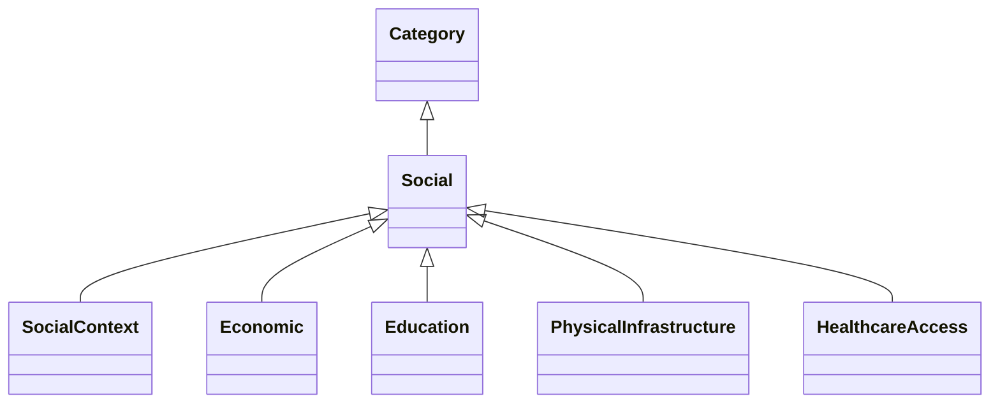

---
search:
  boost: 10.0
---

# Class: Social 


_Root domain for Social_


<div data-search-exclude markdown="1">


URI: [vocab:Social](https://w3id.org/hew/measures/Social)





## Inheritance
* [Category](Category.md)
    * **Social**
        * [SocialContext](SocialContext.md)
        * [Economic](Economic.md)
        * [Education](Education.md)
        * [PhysicalInfrastructure](PhysicalInfrastructure.md)
        * [HealthcareAccess](HealthcareAccess.md)


## Slots

| Name | Cardinality and Range | Description | Inheritance |
| ---  | --- | --- | --- |


## Identifier and Mapping Information


### Schema Source


* from schema: https://w3id.org/hew/measures/schema


## Mappings

| Mapping Type | Mapped Value |
| ---  | ---  |
| self | vocab:Social |
| native | vocab:Social |


## LinkML Source

<!-- TODO: investigate https://stackoverflow.com/questions/37606292/how-to-create-tabbed-code-blocks-in-mkdocs-or-sphinx -->

### Direct

<details>
```yaml
name: Social
description: Root domain for Social
from_schema: https://w3id.org/hew/measures/schema
is_a: Category

```
</details>

### Induced

<details>
```yaml
name: Social
description: Root domain for Social
from_schema: https://w3id.org/hew/measures/schema
is_a: Category

```
</details></div>