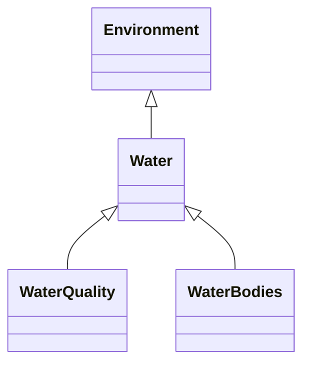

---
search:
  boost: 10.0
---

# Class: Water 


_Subcategory: Water_


<div data-search-exclude markdown="1">


URI: [vocab:Water](https://w3id.org/hew/measures/Water)





## Inheritance
* [Category](Category.md)
    * [Environment](Environment.md)
        * **Water**
            * [WaterQuality](WaterQuality.md)
            * [WaterBodies](WaterBodies.md)


## Slots

| Name | Cardinality and Range | Description | Inheritance |
| ---  | --- | --- | --- |


## Identifier and Mapping Information


### Schema Source


* from schema: https://w3id.org/hew/measures/schema


## Mappings

| Mapping Type | Mapped Value |
| ---  | ---  |
| self | vocab:Water |
| native | vocab:Water |


## LinkML Source

<!-- TODO: investigate https://stackoverflow.com/questions/37606292/how-to-create-tabbed-code-blocks-in-mkdocs-or-sphinx -->

### Direct

<details>
```yaml
name: Water
description: 'Subcategory: Water'
from_schema: https://w3id.org/hew/measures/schema
is_a: Environment

```
</details>

### Induced

<details>
```yaml
name: Water
description: 'Subcategory: Water'
from_schema: https://w3id.org/hew/measures/schema
is_a: Environment

```
</details></div>